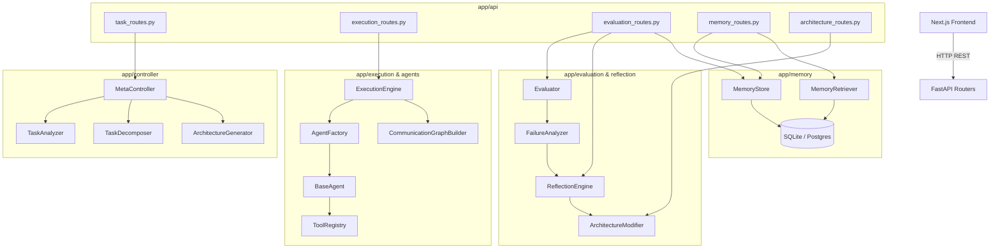

# Agent Forge — Comprehensive Functional Audit & Implementation Gap Analysis

**Date & Time**: 2026-10-23T19:50:00+05:30  
**Repository**: [Agent_Forge](https://github.com/Anuj2862/Agent_Forge)  
**Workspace Directory**: `/Users/anuj/Desktop/EDI-5`  
**Auditor**: Senior Systems Architect, Multi-Agent Systems Engineer & Integration Specialist  
**Audit Mode**: Non-destructive, Evidence-Based Audit Only (Zero Code Fixes Applied)

---

## 1. Executive Summary & Repository State

### 1.1 Git Status & Commit Provenance
- **Current Branch**: `main` (tracked with `origin/main`, clean working tree)
- **Latest Commit**: `08923370b7f3d01c2b70b657db1bb4b850b83fee`
- **Commit Message**: `feat(theme): implement futuristic holographic cyberpunk multi-agent command center theme`
- **Author**: Gauri Kadalge <gaurikadalge02@gmail.com> (Wed Sep 23 2026)
- **Pre-existing User Changes**: None (working tree clean prior to audit).

### 1.2 Environment & Runtime Stack
- **Python Runtime**: `3.13.12` (`/opt/homebrew/Caskroom/miniconda/base/bin/python3`)
- **Node.js Runtime**: `v24.14.0` (`npm 11.9.0`)
- **Backend Manifest** (`requirements.txt`):
  - `fastapi>=0.111.0`, `uvicorn[standard]>=0.30.0`
  - `langgraph>=0.2.0`, `pydantic>=2.7.0`, `pydantic-settings>=2.2.0`
  - `sqlalchemy>=2.0.30`, `aiosqlite>=0.20.0`, `asyncpg>=0.29.0`, `psycopg2-binary>=2.9.9`
  - `google-genai>=0.1.1`, `httpx>=0.27.0`
  - `pytest>=8.2.0`, `pytest-asyncio>=0.23.7`
- **Frontend Manifest** (`frontend/package.json`):
  - `next: 16.3.5`, `react: 19.2.8`, `react-dom: 19.2.8`
  - `reactflow: ^11.11.4`, `recharts: ^3.10.1`, `axios: ^1.20.0`
  - `@radix-ui/react-dialog`, `@radix-ui/react-progress`, `@radix-ui/react-tabs`
  - `tailwindcss: ^4`

---

## 2. Architecture Map & Subsystem Interconnections

The repository was built through 4 member assignments:
- **Member 1 (`app/controller`)**: Task Analyzer, Decomposer, Capability Extractor, Complexity Analyzer, Architecture Generator.
- **Member 2 (`app/execution`, `app/agents`, `app/tools`)**: Tool Registry, Agent Factory, BaseAgent, LangGraph CommunicationGraphBuilder, ExecutionEngine.
- **Member 3 (`app/evaluation`, `app/reflection`)**: Quality Scorer, Metrics Calculator, Evaluator, Failure Analyzer, Improvement Generator, Architecture Modifier.
- **Member 4 (`app/api`, `app/memory`, `frontend`)**: Database/ORM, Memory Store, Memory Retriever, FastAPI Routers, Next.js UI.

### Critical Architecture Disconnects Discovered
1. **Passive Memory Void**: `MC` (MetaController) **never** invokes `MRET` (MemoryRetriever). Architecture generation is completely memory-blind.
2. **Missing Evolution Decision Engine**: No subsystem evaluates whether V2 is ACCEPTED, REJECTED, or INCONCLUSIVE against constraints and evidence.
3. **In-Memory Volatility**: `_task_store`, `_execution_store`, and `_evaluation_store` are local Python dictionaries in memory. On process restart, all tasks, runs, and evaluations are destroyed; the SQLite database stores only passive `EvolutionMemoryRecord` rows.

---

## 3. Verification Commands & Runtime Results

| Check / Command | Exit Status | Result / Output | Findings |
|---|:---:|---|---|
| `pytest -v` | **0 (PASS)** | **129 passed**, 72 warnings in 9.38s | All unit and mocked integration tests pass cleanly. 72 deprecation warnings from Pydantic V1 `class Config` and `datetime.utcnow()`. |
| `npm --prefix frontend run lint` | **1 (FAIL)** | **80 problems (60 errors, 20 warnings)** | Fails due to `@typescript-eslint/no-explicit-any` across 10 files and unescaped quotes in `ArchitectureGraph.tsx`. |
| `npm --prefix frontend run build` | **0 (PASS)** | Compiled in 2.1s, 12 static/dynamic routes generated | Production Next.js build succeeds with Turbopack. |
| `uvicorn app.main:app --port 8001` | **0 (PASS)** | Server started, `/health` endpoint responsive | FastAPI server boots and initializes SQLite tables via lifespan `init_db()`. |
| Live E2E API Workflow (curl) | **0 (PASS)** | Submit → Run 1 → Evaluate 1 → Evolve V2 → Run 2 → Evaluate 2 → Compare | End-to-end HTTP pipeline executes without crashing. However, critical constraint and integrity bugs were revealed during execution. |

---

## 4. End-to-End Pipeline Audit (Stages 1 – 12)

### Stage 1: Task Submission
- **API Endpoint**: `POST /tasks/submit` ([task_routes.py:44](file:///Users/anuj/Desktop/EDI-5/app/api/task_routes.py#L44))
- **Schema**: `TaskSubmitRequest(user_prompt: str, run_number: Optional[int] = 1)`
- **Behavior**:
  - Validates `user_prompt` non-empty (returns 400 if empty).
  - Generates stable `task_id` (`task_...`).
  - Returns `TaskSubmitResponse` containing `TaskSpec` and `ArchitectureSpec`.
- **Gaps / Defects**:
  - Request schema **does not accept constraints** (no `constraints`, `max_agents`, or `timeout` fields).
  - Tasks are saved **only** in memory (`_task_store: dict`). Server restart loses all submitted tasks.

### Stage 2: Task Analysis & Decomposition
- **Module**: `app/controller/task_analyzer.py` ([task_analyzer.py:33](file:///Users/anuj/Desktop/EDI-5/app/controller/task_analyzer.py#L33)), `task_decomposer.py`
- **Behavior**:
  - If `GEMINI_API_KEY` is configured, calls Gemini `gemini-1.5-pro` with structured JSON output.
  - If offline or key absent, transparently falls back to `_heuristic_analyze()`.
- **Gaps / Defects**:
  - In `_heuristic_analyze()`, `constraints` is hardcoded as `constraints=[]` ([task_analyzer.py:73](file:///Users/anuj/Desktop/EDI-5/app/controller/task_analyzer.py#L73)). Even if the user prompt explicitly specifies `"Hard constraint: max_agents=2"`, the extracted constraint list is empty!
  - Subtasks generated in offline mode are fixed templates ("Data & Context Retrieval", "Synthesis & Analysis").

### Stage 3: Architecture Generation
- **Module**: `app/controller/architecture_generator.py` ([architecture_generator.py:19](file:///Users/anuj/Desktop/EDI-5/app/controller/architecture_generator.py#L19))
- **Topologies Supported**: Only `TopologyType.PIPELINE` and `TopologyType.PARALLEL`. (`SEQUENTIAL` is treated as PIPELINE; `HIERARCHICAL`, `COLLABORATIVE`, `DEBATE` are not implemented).
- **Behavior**:
  - Maps 1 subtask directly to 1 agent.
  - Sets roles, objectives, system prompts, input/output keys.
- **Gaps / Defects**:
  - **Zero constraint enforcement**: `generate_architecture` never checks `max_agents` or hard limits.
  - Does not consult past experiences from `MemoryRetriever`.

### Stage 4: Agent Instantiation & LangGraph Execution
- **Module**: `app/execution/execution_engine.py` ([execution_engine.py:81](file:///Users/anuj/Desktop/EDI-5/app/execution/execution_engine.py#L81)), `communication_graph.py`, `app/agents/base_agent.py`
- **Behavior**:
  - Real LangGraph `StateGraph` compiled and invoked dynamically with nodes, edges, `START`, and `END`.
  - Node functions dynamically pass upstream state context through `enriched_prompt`.
  - When `GEMINI_API_KEY` is present, calls Gemini live. When absent, returns reproducible deterministic mock LLM string with agent role and objective.
- **Gaps / Defects**:
  - In `BaseAgent.execute()`, all assigned tools are called **unconditionally in a loop** ([base_agent.py:102](file:///Users/anuj/Desktop/EDI-5/app/agents/base_agent.py#L102)), rather than being invoked dynamically via tool calling / reasoning.
  - For `python_interpreter_tool`, it executes a fallback `"print('executing python tool')"` if no code is present in state.
  - For `document_retriever_tool`, synthetic static mock documents are returned.

### Stage 5: Execution Events, Telemetry, and Replay
- **Endpoints**: `POST /execution/run`, `GET /execution/{execution_id}`, `GET /execution/`
- **Gaps / Defects**:
  - **No SSE or WebSockets**: Neither backend nor frontend implements Server-Sent Events or WebSockets.
  - "Telemetry" is simply the final post-run payload containing `step_history` and `agent_logs`.
  - "Replay" is a post-hoc linear viewer of past step cards, not an event-sourced reconstructable execution timeline.

### Stage 6: Evaluation
- **Module**: `app/evaluation/evaluator.py`, `metrics.py`, `quality_scorer.py`
- **Behavior**:
  - Evaluates `task_success`, `quality`, `completeness`, `accuracy`, `verification_status`, `tool_efficiency`, and `cost_efficiency`.
  - Quality is scored deterministically based on keyword coverage, structure (markdown headers/bullets), readability (sentence length), substance, and consistency.
  - Explanatory feedback summary generated with strengths and architectural deficiencies.

### Stage 7: Failure Diagnosis
- **Module**: `app/evaluation/failure_analyzer.py`, `app/reflection/reflection_engine.py`
- **Behavior**:
  - Diagnoses 9 root causes: `INSUFFICIENT_VERIFICATION`, `MISSING_TOOL`, `REDUNDANT_AGENTS`, `TOPOLOGY_MISMATCH`, `AGENT_FAILURE`, `DEPENDENCY_FAILURE`, `EXCESSIVE_ITERATIONS`, `INSUFFICIENT_RESEARCH`, `DECOMPOSITION_FAILURE`.
  - Truly evidence-grounded: Inspects agent traces, verification claims, tool calls, and metric scores.

### Stage 8: Architecture Evolution & Constraint Violation
- **Module**: `app/reflection/architecture_modifier.py` ([architecture_modifier.py:35](file:///Users/anuj/Desktop/EDI-5/app/reflection/architecture_modifier.py#L35))
- **Behavior**:
  - Applies recommendations: `ADD_AGENT`, `REMOVE_AGENT`, `ADD_TOOL`, `REMOVE_TOOL`, `CHANGE_AGENT_ROLE`, `ADD_CONNECTION`, `REMOVE_CONNECTION`, `CHANGE_TOPOLOGY`.
  - Performs graph integrity validation (unique IDs, existing sources/targets, cycle detection on new connections).
- **CRITICAL CORRECTNESS FAILURE**:
  - **Bypasses Hard Constraints**: When reflection recommends adding a verification agent, `ArchitectureModifier` adds a 3rd agent to a 2-agent architecture even if the user specified `max_agents=2`.
  - `_validate_architecture_integrity()` does **not** validate candidate agent count against task constraints!

### Stage 9: Evolution Decision Policy (CRITICAL DEFECT: MISSING)
- **Status**: **FAIL / NOT IMPLEMENTED**
- **Evidence**:
  - Ripgrep search for `decision`, `accepted`, `rejected`, or `inconclusive` yields 0 matches in business logic.
  - `compare_task_runs()` in `evaluation_routes.py` simply computes numerical differences (`deltas`) and topological diffs (`architecture_diff`).
  - **No policy exists** to decide whether V2 should be ACCEPTED or REJECTED.
  - If V2 achieves higher quality but violates `max_agents=2`, the system makes no objection and presents V2 as the evolved architecture.

### Stage 10: Persistent Memory
- **Module**: `app/memory/memory_store.py`, `memory_retriever.py`, `database.py`
- **Behavior**:
  - `EvolutionMemoryRecord` stored in SQLite via SQLAlchemy async engine (`agentforge_memory.db`).
  - Retrieval by `task_type` and `complexity` works in isolation.
- **Gaps / Defects**:
  - **Memory is completely passive**: Neither `MetaController` nor `ArchitectureGenerator` calls `MemoryRetriever`.
  - The claim on the UI (`frontend/app/history/page.tsx:54`) that "On every new task submission, the retrieval engine searches this database... preventing the Meta Controller from repeating known mistakes" is **unimplemented**.

### Stage 11: API and Database Integrity
- **Persistence Gap**:
  - Only `EvolutionMemoryRecord` is saved to SQLite.
  - Tasks (`_task_store`), Executions (`_execution_store`), and Evaluations (`_evaluation_store`) are held solely in Python memory dictionaries.
  - If the server restarts, `GET /tasks/`, `GET /execution/`, and `GET /evaluation/` return empty arrays.
  - `GET /tasks/{task_id}` has an ad-hoc recovery mechanism from memory records, but it does not restore execution traces or evaluation history.

### Stage 12: Frontend–Backend Integration
- **Contract Gaps Discovered**:
  1. **Diagnosis Page Broken**: `frontend/app/diagnosis/page.tsx:83` attempts to read `taskData?.latest_evaluation?.reflection_result`. The backend sets `task_data["latest_evaluation_id"]`, never `latest_evaluation`. Consequently, the diagnosis page **never renders reflections**.
  2. **Evaluation Fallback Broken**: `frontend/app/evaluation/page.tsx:31` checks `firstTask.data.latest_evaluation`, which is never populated.
  3. **Memory Query 400 Error**: `frontend/app/memory/page.tsx:16` includes `multi_hop_qa` and `creative_writing` in its task type dropdown. Backend `TaskType` rejects these with HTTP 400.
  4. **Hardcoded UI Table Values**: In `frontend/app/evolution/page.tsx:259`, `+48.0%` delta is hardcoded in the HTML table regardless of actual data.
  5. **Fake Settings Save**: `frontend/app/settings/page.tsx:31` has a mock `handleSave()` that simply sets a local timeout banner without sending any API request.
  6. **Hardcoded Holographic War Room**: `HolographicWarRoom.tsx` renders 4 hardcoded demo agents (`researcher`, `planner`, `analyst`, `executor`) and simulated SVG waves instead of live task architectures.

---

## 5. Evidence-Based Gap Matrix

| ID | Feature | Intended Behavior | Actual Implementation | Evidence | Status | Impact | Required Action |
|---|---|---|---|---|:---:|---|---|
| **GAP-01** | **Hard Constraint Enforcement** | System must reject candidates that violate hard limits (e.g., `max_agents=2`). | Hard constraints are ignored during decomposition, synthesis, evolution, and comparison. | [test_constraint_audit.py](file:///Users/anuj/.gemini/antigravity-ide/brain/93d3bff8-b695-49a9-bbdf-6bdf8ad21a77/scratch/test_constraint_audit.py); [task_analyzer.py:73](file:///Users/anuj/Desktop/EDI-5/app/controller/task_analyzer.py#L73); [architecture_modifier.py:121](file:///Users/anuj/Desktop/EDI-5/app/reflection/architecture_modifier.py#L121) | **FAIL** | **P0** (Integrity) | Parse constraints in `TaskAnalyzer`; validate constraints in `ArchitectureModifier` & add backend rejection. |
| **GAP-02** | **Evolution Decision Policy** | Evaluate V1 vs V2 and emit a formal decision: ACCEPTED, REJECTED, or INCONCLUSIVE with reason codes. | No decision logic exists; endpoint only outputs raw mathematical metric deltas. | [evaluation_routes.py:227](file:///Users/anuj/Desktop/EDI-5/app/api/evaluation_routes.py#L227); 0 occurrences of decision policy in code | **FAIL** | **P0** (Core Concept) | Implement `EvolutionDecisionPolicy` checking hard constraints, quality threshold, regression, and complexity trade-offs. |
| **GAP-03** | **Task & Execution DB Persistence** | Tasks, architectures, and executions must survive server restarts. | Stored in in-memory dicts (`_task_store`, `_execution_store`); wiped on reload. | [task_routes.py:26](file:///Users/anuj/Desktop/EDI-5/app/api/task_routes.py#L26); [execution_routes.py:19](file:///Users/anuj/Desktop/EDI-5/app/api/execution_routes.py#L19) | **FAIL** | **P0** (Persistence) | Create SQLAlchemy ORM models for Task, Architecture, and Execution; persist all state on creation. |
| **GAP-04** | **Active Memory Integration** | Prior successful architectures must inform `MetaController` synthesis to avoid past failures. | `MemoryRetriever` is only exposed via `/memory/` routes; `MetaController` never queries memory. | [meta_controller.py:29](file:///Users/anuj/Desktop/EDI-5/app/controller/meta_controller.py#L29); 0 imports of `MemoryRetriever` in `app/controller/` | **FAIL** | **P1** (Core Concept) | Wire `MemoryRetriever` into `MetaController.process_task_with_spec()`. |
| **GAP-05** | **Frontend Contract: `latest_evaluation`** | Diagnosis page should display reflection critiques for the current task. | Frontend expects `latest_evaluation.reflection_result`; backend sets `latest_evaluation_id`. Diagnosis page displays empty state. | [diagnosis/page.tsx:83](file:///Users/anuj/Desktop/EDI-5/frontend/app/diagnosis/page.tsx#L83); [evaluation_routes.py:176](file:///Users/anuj/Desktop/EDI-5/app/api/evaluation_routes.py#L176) | **FAIL** | **P1** (Broken UX) | Standardize backend task state to include `latest_evaluation` object or update frontend to fetch by ID. |
| **GAP-06** | **Frontend TypeScript / ESLint Errors** | Frontend code must pass standard lint and typing checks. | `npm run lint` fails with 60 errors (`any` types, unescaped JSX quotes). | `frontend/app/evolution/page.tsx:15`, `ArchitectureGraph.tsx:183`, `lib/api.ts:62` | **PARTIAL** | **P2** (Code Quality) | Add explicit TypeScript types and escape JSX entities. |
| **GAP-07** | **Task Submission Constraints Schema** | User can submit explicit constraints via API and UI. | `TaskSubmitRequest` only accepts `user_prompt` and `run_number`. UI form has no constraint inputs. | [task_routes.py:32](file:///Users/anuj/Desktop/EDI-5/app/api/task_routes.py#L32); [TaskSubmitForm.tsx:155](file:///Users/anuj/Desktop/EDI-5/frontend/components/TaskSubmitForm.tsx#L155) | **PARTIAL** | **P1** (Pipeline) | Add `constraints: List[str]` and `max_agents: Optional[int]` to request schema and UI form. |
| **GAP-08** | **Live Event Streaming (SSE / Telemetry)** | Real-time agent state transitions, tool invocations, and error events streamed during execution. | Execution is a single synchronous/blocking call; client polls or waits for complete batch result. | [execution_routes.py:34](file:///Users/anuj/Desktop/EDI-5/app/api/execution_routes.py#L34); 0 SSE / WebSocket endpoints | **PARTIAL** | **P2** (Observability) | Add LangGraph streaming callback handler and FastAPI SSE endpoint (`/execution/{id}/stream`). |
| **GAP-09** | **Hardcoded Comparison UI Elements** | Comparison table displays accurate deltas calculated from real execution data. | Table contains hardcoded values (`+48.0%`, badges) and fallback values that mask null data. | [evolution/page.tsx:259](file:///Users/anuj/Desktop/EDI-5/frontend/app/evolution/page.tsx#L259) | **PARTIAL** | **P2** (Truthfulness) | Replace hardcoded text and badges with dynamic values from `comparison.deltas`. |
| **GAP-10** | **Dynamic Tool Reasoning in BaseAgent** | Agents reason about when to call tools and with what parameters. | Tools are executed unconditionally in a `for tool in self.tools` loop with static arguments. | [base_agent.py:102](file:///Users/anuj/Desktop/EDI-5/app/agents/base_agent.py#L102) | **PARTIAL** | **P2** (Agent Logic) | Implement tool decision logic or prompt-based tool dispatching within `BaseAgent`. |

---

## 6. Mock, Fallback & Simulation Inventory

| Component | Mode | Location | Trigger Condition | Real Path Available? |
|---|---|---|---|---|
| **Task Analysis** | Heuristic Fallback | `app/controller/task_analyzer.py:33` | Missing `GEMINI_API_KEY` | Yes (Gemini 1.5 Pro) |
| **LLM Execution** | Deterministic String Mock | `app/agents/base_agent.py:44` | Missing `GEMINI_API_KEY` | Yes (Gemini API) |
| **Web Search Tool** | Offline Result Dict | `app/tools/web_search.py:37` | Missing `TAVILY_API_KEY` or `SERPER_API_KEY` | Yes (Tavily HTTP POST) |
| **Document Retriever** | Synthetic Docs Generator | `app/tools/document_retriever.py:27` | Always (mock implementation) | No (requires Vector DB / RAG integration) |
| **Python Tool** | Restricted Exec Engine | `app/tools/python_tool.py:35` | Always (real in-process restricted Python exec) | Yes (executes real Python AST) |
| **Simulated Subsystems** | Full Simulation Classes | `app/api/simulate.py` | `AGENT_FORGE_MODE="simulation"` | Yes (default is `real`) |

---

## 7. Constraint & Evolution Decision Deep-Dive

### Empirical Evidence of Constraint Violation
During our live audit run:
1. **User Request**: `"Research quantum computing developments in 2026. Hard constraint: max_agents=2."`
2. **Initial Synthesis (Run 1)**: Produced a 2-agent architecture (`subtask_1`, `subtask_2`). But `task_spec.constraints` was recorded as `[]`.
3. **Reflection & Evolution**: Evaluator diagnosed `INSUFFICIENT_VERIFICATION` and recommended `ADD_AGENT: fact_verification_agent`.
4. **ArchitectureModifier Action**: Added `fact_verification_agent` directly between `subtask_1` and `subtask_2`. Evolved agent count became **3 agents**.
5. **Integrity Check**: `_validate_architecture_integrity` passed with 0 errors because it only checks ID uniqueness and dangling edges.
6. **Candidate Execution (Run 2)**: The 3-agent candidate was executed without restriction.
7. **Comparison Delta**: `deltas.agent_count = 1`.
8. **Decision**: **No decision was produced.** The system treated V2 as the new accepted architecture despite directly violating the user's hard constraint of 2 agents.

### Policy Rules Required for Decision Engine
A defensible `EvolutionDecisionPolicy` must enforce:
1. **Hard Constraints are Inviolable**: If `candidate.agent_count > task.max_agents`, status **MUST BE REJECTED**, regardless of quality improvements.
2. **Quality Threshold**: Candidate must improve overall score by at least `min_improvement_delta` (e.g. $\ge 0.05$) without regressing task success.
3. **Regression Guard**: If any core metric (e.g. `task_success`, `accuracy`) drops by $> 10\%$, candidate is **REJECTED**.
4. **Complexity vs Gain Trade-off**: If agent count increases, the quality gain must exceed a complexity penalty threshold.
5. **Inconclusive Handling**: If evaluation evidence is missing or execution errored out, status is **INCONCLUSIVE**.

---

## 8. Prioritized Implementation Roadmap

### Phase P0 — Critical Correctness & Integrity (Must Be Fixed First)
1. **P0.1: Hard Constraint Validation & Enforcement**
   - **Files**: [app/schemas/task.py](file:///Users/anuj/Desktop/EDI-5/app/schemas/task.py), [app/controller/task_analyzer.py](file:///Users/anuj/Desktop/EDI-5/app/controller/task_analyzer.py), [app/reflection/architecture_modifier.py](file:///Users/anuj/Desktop/EDI-5/app/reflection/architecture_modifier.py), [app/api/task_routes.py](file:///Users/anuj/Desktop/EDI-5/app/api/task_routes.py)
   - **Goal**: Accept `max_agents` and constraint list in `TaskSubmitRequest`. Extract constraints in `TaskAnalyzer`. Enforce hard constraint check in `ArchitectureModifier._validate_architecture_integrity()` to reject mutations that exceed limits.
2. **P0.2: Evolution Decision Engine**
   - **Files**: `app/evaluation/decision_policy.py` (new), [app/api/evaluation_routes.py](file:///Users/anuj/Desktop/EDI-5/app/api/evaluation_routes.py), [app/schemas/evaluation.py](file:///Users/anuj/Desktop/EDI-5/app/schemas/evaluation.py)
   - **Goal**: Implement deterministic decision policy returning `ACCEPTED`, `REJECTED`, or `INCONCLUSIVE` with explicit reason codes and evidence rationale.
3. **P0.3: Database Persistence for Tasks & Executions**
   - **Files**: [app/memory/database.py](file:///Users/anuj/Desktop/EDI-5/app/memory/database.py), [app/memory/memory_store.py](file:///Users/anuj/Desktop/EDI-5/app/memory/memory_store.py), [app/api/task_routes.py](file:///Users/anuj/Desktop/EDI-5/app/api/task_routes.py), [app/api/execution_routes.py](file:///Users/anuj/Desktop/EDI-5/app/api/execution_routes.py)
   - **Goal**: Add ORM tables for `TaskRecord`, `ArchitectureRecord`, and `ExecutionRecord`. Store tasks and executions on creation so data survives server restarts.

### Phase P1 — Core Workflow Completeness
4. **P1.1: Active Memory-Augmented Architecture Synthesis**
   - **Files**: [app/controller/meta_controller.py](file:///Users/anuj/Desktop/EDI-5/app/controller/meta_controller.py), [app/controller/architecture_generator.py](file:///Users/anuj/Desktop/EDI-5/app/controller/architecture_generator.py), [app/api/task_routes.py](file:///Users/anuj/Desktop/EDI-5/app/api/task_routes.py)
   - **Goal**: Query `MemoryRetriever` for prior high-rated architectures before generating a new architecture.
5. **P1.2: Fix Frontend–Backend Contract Mismatches**
   - **Files**: [frontend/app/diagnosis/page.tsx](file:///Users/anuj/Desktop/EDI-5/frontend/app/diagnosis/page.tsx), [frontend/app/memory/page.tsx](file:///Users/anuj/Desktop/EDI-5/frontend/app/memory/page.tsx), [app/api/task_routes.py](file:///Users/anuj/Desktop/EDI-5/app/api/task_routes.py)
   - **Goal**: Include `latest_evaluation` in task responses so diagnosis works; align `TaskType` options in memory UI.
6. **P1.3: Decision Display & Real Delta Rendering in Frontend**
   - **Files**: [frontend/app/evolution/page.tsx](file:///Users/anuj/Desktop/EDI-5/frontend/app/evolution/page.tsx), [frontend/app/run/[task_id]/page.tsx](file:///Users/anuj/Desktop/EDI-5/frontend/app/run/[task_id]/page.tsx)
   - **Goal**: Display the formal evolution decision (`ACCEPTED` / `REJECTED`), remove hardcoded `+48.0%` strings, and bind decision badges.

### Phase P2 — Reliability & Observability
7. **P2.1: Real-time SSE Execution Event Streaming**
   - **Files**: [app/api/execution_routes.py](file:///Users/anuj/Desktop/EDI-5/app/api/execution_routes.py), [app/execution/communication_graph.py](file:///Users/anuj/Desktop/EDI-5/app/execution/communication_graph.py), [frontend/lib/api.ts](file:///Users/anuj/Desktop/EDI-5/frontend/lib/api.ts)
   - **Goal**: Emit real-time agent start/finish and tool events over SSE.
8. **P2.2: Fix ESLint Violations in Frontend**
   - **Files**: 10 frontend files with `@typescript-eslint/no-explicit-any` and unescaped entities.
   - **Goal**: Ensure `npm run lint` exits 0.

### Phase P3 — Polish & Developer Experience
9. **P3.1: Replace Hardcoded War Room with Real Architecture Graph**
   - **Files**: [frontend/components/HolographicWarRoom.tsx](file:///Users/anuj/Desktop/EDI-5/frontend/components/HolographicWarRoom.tsx)
   - **Goal**: Bind the home dashboard visualization to active or recent tasks.

---

## 9. Recommended First Fix

### Target: P0.1 & P0.2 — Constraint Enforcement & Evolution Decision Policy
**Why This First**: This directly tackles the foundational thesis of Agent Forge: *Failure-Driven, Constraint-Aware Self-Evolution*. Without constraint checking and an evolution decision policy, Agent Forge cannot fulfill its core scientific promise of making defensible decisions about whether an evolved architecture should be accepted or rejected.

**Exact Files Involved**:
1. [app/schemas/task.py](file:///Users/anuj/Desktop/EDI-5/app/schemas/task.py) — Add explicit `max_agents: Optional[int] = None` field to `TaskSpec`.
2. [app/api/task_routes.py](file:///Users/anuj/Desktop/EDI-5/app/api/task_routes.py) — Add `max_agents` and `constraints` to `TaskSubmitRequest`.
3. [app/controller/task_analyzer.py](file:///Users/anuj/Desktop/EDI-5/app/controller/task_analyzer.py) — Parse regex for constraints (e.g. `max_agents=(\d+)`) in heuristic fallback.
4. [app/reflection/architecture_modifier.py](file:///Users/anuj/Desktop/EDI-5/app/reflection/architecture_modifier.py) — Pass `TaskSpec` constraints into `_validate_architecture_integrity()`; reject any mutation that exceeds `max_agents`.
5. `app/evaluation/decision_policy.py` — New module implementing `EvolutionDecisionPolicy` with `EvolutionDecision(status: ACCEPTED|REJECTED|INCONCLUSIVE, rationale: str, reason_codes: List[str])`.
6. [app/api/evaluation_routes.py](file:///Users/anuj/Desktop/EDI-5/app/api/evaluation_routes.py) — Call `EvolutionDecisionPolicy` in `compare_task_runs()` and attach `decision` to the response.

---

## 10. Verification Plan

Once the first fix is approved for implementation, verify using:
1. **Unit Test**: Test that `ArchitectureModifier` refuses to add an agent when `base_architecture` already has `max_agents` count.
2. **Decision Policy Unit Tests**:
   - Case A: Higher quality, but `candidate.agent_count > max_agents` $\rightarrow$ **REJECTED** (Reason: `HARD_CONSTRAINT_VIOLATION`).
   - Case B: Higher quality ($+15\%$), within constraints $\rightarrow$ **ACCEPTED** (Reason: `QUALITY_IMPROVEMENT`).
   - Case C: Lower quality ($-5\%$) with no constraint violation $\rightarrow$ **REJECTED** (Reason: `QUALITY_REGRESSION`).
   - Case D: Errored execution $\rightarrow$ **REJECTED** (Reason: `EXECUTION_FAILURE`).
3. **Integration Test (pytest)**: Run full E2E pipeline with a 2-agent limit and verify that the comparison endpoint returns `status: "rejected"`.
4. **Terminal curl Check**: Live request to `http://localhost:8000/evaluation/compare/{task_id}` showing `decision.status == "rejected"`.

---
*Report completed and preserved in `docs/FUNCTIONAL_AUDIT.md`. Execution paused per STOP CONDITION.*
